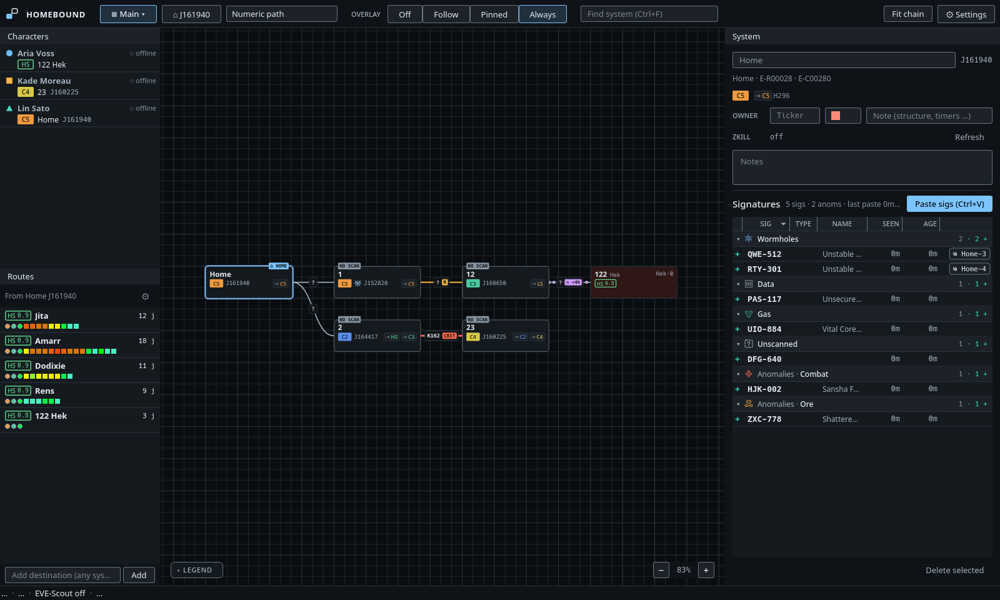
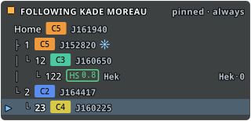
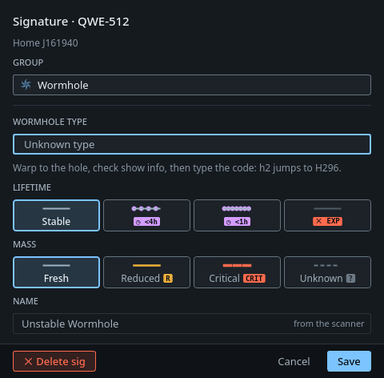

# Homebound

An offline wormhole mapper for EVE Online. Homebound follows your characters through EVE's Local chat logs, builds the chain as you jump, names new systems with the scheme you pick, and shows the chain your active character is in on a small overlay over the game. It needs no ESI login, and all map data stays on your machine.

Runs on Linux and Windows.

## Install on Linux

Paste the block for your distribution into a terminal (bash, zsh or fish). It installs the two libraries the AppImage needs, downloads the latest release to `~/.local/bin/homebound` and adds Homebound to your app menu. Run the same block again to update.

**Debian, Ubuntu, Mint, Pop!_OS**

```sh
sudo apt install -y curl fuse3 libxcb-cursor0 && \
mkdir -p ~/.local/bin ~/.local/share/applications ~/.local/share/icons/hicolor/256x256/apps && \
curl -fsSL https://api.github.com/repos/luto2/homebound/releases/latest | grep -o 'https://[^"]*x86_64\.AppImage' | head -n1 | xargs curl -fL -o ~/.local/bin/homebound && \
chmod +x ~/.local/bin/homebound && \
curl -fsSL -o ~/.local/share/icons/hicolor/256x256/apps/homebound.png https://raw.githubusercontent.com/luto2/homebound/master/packaging/icons/homebound.png && \
curl -fsSL https://raw.githubusercontent.com/luto2/homebound/master/packaging/linux/homebound.desktop | sed "s|^Exec=.*|Exec=$HOME/.local/bin/homebound|" > ~/.local/share/applications/homebound.desktop && \
echo "Homebound installed. Start it from the app menu or with ~/.local/bin/homebound"
```

**Fedora**

```sh
sudo dnf install -y curl fuse3 xcb-util-cursor && \
mkdir -p ~/.local/bin ~/.local/share/applications ~/.local/share/icons/hicolor/256x256/apps && \
curl -fsSL https://api.github.com/repos/luto2/homebound/releases/latest | grep -o 'https://[^"]*x86_64\.AppImage' | head -n1 | xargs curl -fL -o ~/.local/bin/homebound && \
chmod +x ~/.local/bin/homebound && \
curl -fsSL -o ~/.local/share/icons/hicolor/256x256/apps/homebound.png https://raw.githubusercontent.com/luto2/homebound/master/packaging/icons/homebound.png && \
curl -fsSL https://raw.githubusercontent.com/luto2/homebound/master/packaging/linux/homebound.desktop | sed "s|^Exec=.*|Exec=$HOME/.local/bin/homebound|" > ~/.local/share/applications/homebound.desktop && \
echo "Homebound installed. Start it from the app menu or with ~/.local/bin/homebound"
```

**Arch, CachyOS, Manjaro, EndeavourOS**

```sh
sudo pacman -S --needed --noconfirm curl fuse3 xcb-util-cursor && \
mkdir -p ~/.local/bin ~/.local/share/applications ~/.local/share/icons/hicolor/256x256/apps && \
curl -fsSL https://api.github.com/repos/luto2/homebound/releases/latest | grep -o 'https://[^"]*x86_64\.AppImage' | head -n1 | xargs curl -fL -o ~/.local/bin/homebound && \
chmod +x ~/.local/bin/homebound && \
curl -fsSL -o ~/.local/share/icons/hicolor/256x256/apps/homebound.png https://raw.githubusercontent.com/luto2/homebound/master/packaging/icons/homebound.png && \
curl -fsSL https://raw.githubusercontent.com/luto2/homebound/master/packaging/linux/homebound.desktop | sed "s|^Exec=.*|Exec=$HOME/.local/bin/homebound|" > ~/.local/share/applications/homebound.desktop && \
echo "Homebound installed. Start it from the app menu or with ~/.local/bin/homebound"
```

**openSUSE**

```sh
sudo zypper install -y curl fuse3 libxcb-cursor0 && \
mkdir -p ~/.local/bin ~/.local/share/applications ~/.local/share/icons/hicolor/256x256/apps && \
curl -fsSL https://api.github.com/repos/luto2/homebound/releases/latest | grep -o 'https://[^"]*x86_64\.AppImage' | head -n1 | xargs curl -fL -o ~/.local/bin/homebound && \
chmod +x ~/.local/bin/homebound && \
curl -fsSL -o ~/.local/share/icons/hicolor/256x256/apps/homebound.png https://raw.githubusercontent.com/luto2/homebound/master/packaging/icons/homebound.png && \
curl -fsSL https://raw.githubusercontent.com/luto2/homebound/master/packaging/linux/homebound.desktop | sed "s|^Exec=.*|Exec=$HOME/.local/bin/homebound|" > ~/.local/share/applications/homebound.desktop && \
echo "Homebound installed. Start it from the app menu or with ~/.local/bin/homebound"
```

To uninstall: `rm ~/.local/bin/homebound ~/.local/share/applications/homebound.desktop ~/.local/share/icons/hicolor/256x256/apps/homebound.png`. Your maps stay in `~/.local/share/homebound/`.

On first start Homebound offers to download the EVE game data (about 100 MB), then opens Settings on the log folder. [Getting started](#getting-started) has the rest.



## What it does

- **Maps jumps from the Local logs.** A gate jump only moves the character. A jump into or out of w-space adds the system and the connection. A k-space jump without a gate (bridge, filament) asks first.
- **Names systems for you.** Numeric path (`1 → 12 → 123`), `A1a / A2b`, or letter-led (`A → A2 → A23`), with EVE University's chain letters. When the name depends on it, Homebound asks "was this the static?" with its best guess preselected.
- **Keeps your signatures.** Paste the probe scanner with Ctrl+V. New sigs are marked, missing ones are flagged so you can keep or delete them, and systems that are due for a rescan are hatched on the map.
- **Tracks hole state.** Mass, lifetime, type and size per connection, drawn on the line. Holes expire on their own.
- **Shows the chain in game.** The overlay follows the focused EVE client, or stays pinned to one character.
- **Plans routes** to the trade hubs and your own destinations, through stargates, your mapped holes and EVE-Scout's public Thera and Turnur connections.
- **Backs itself up.** One zip a day, plus one before anything risky. Removing a system, a connection or sigs shows an Undo toast for 8 seconds.

<p>
  
  
</p>

## Install

Releases on GitHub have ready-made packages:

- **Linux**: `Homebound-<version>-x86_64.AppImage`. [Install on Linux](#install-on-linux) has a copy-paste command per distribution.
- **Windows**: `Homebound-<version>-windows-setup.exe` installs for your user only (no admin rights), with a Start menu entry and optional autostart. `Homebound-<version>-windows-portable.zip` is the same program to unpack anywhere. The builds aren't signed yet, so SmartScreen warns on the first start: *More info → Run anyway*.

The packages contain no EVE game data. On first start Homebound offers to download the EVE static data export and the community wormhole data (about 100 MB) and builds its universe data from them, which takes a minute or so.

## Getting started

1. In EVE, turn on *Settings → Chat → Log chat to file*.
2. Start Homebound. Settings opens on **Log folder**: click **Auto-detect** (it checks Steam/Proton prefixes on Linux and the Documents folder, OneDrive included, on Windows) or browse to your `Chatlogs` folder.
3. Set your home system and pick a naming scheme.
4. Undock and jump. To add sigs, select a system, press Ctrl+A and Ctrl+C in the probe scanner, then Ctrl+V in Homebound.

On KDE Plasma (Wayland), install the KWin focus script once under **Settings → KWin focus script** so the overlay can follow the focused client. On Windows, run EVE windowed or borderless: no window can sit above exclusive fullscreen.

**[HOW_TO.md](HOW_TO.md) is the full manual**: naming and bookmarks, the signature table, editing the map by hand, several maps, the overlay modes, settings, keys, backups and troubleshooting.

## Network access

After the one-time data download, Homebound works offline. Two optional lookups remain, and both can be turned off in Settings:

- zKillboard kill activity for systems in visible chains (one request per second at most, cached for 10 minutes).
- EVE-Scout's public list of Thera and Turnur connections, for routes (every 5 minutes; nothing about you or your map is sent).

Data lives in `~/.local/share/homebound/` on Linux and `%APPDATA%\Homebound\` on Windows. Each map is a plain SQLite file.

## Run from source

Python 3.12 or newer and [uv](https://docs.astral.sh/uv/):

```sh
uv sync
uv run python -m homebound.universe.build_static   # once: EVE SDE + statics -> data/universe.sqlite
uv run python -m homebound
```

## Static data

- **EVE SDE** (Static Data Export): systems, classes, security, stargates, effects (via the secondary sun type).
- **Wanderer** (MIT) `wormholeSystems.json` / `wormholes.json` and **anoik.is** `static.json`: statics and wormhole types.
- **whtype.info** `wormholes.js`: which classes each type can wander into, so the type dropdown only offers holes that can actually be there.
- Where Wanderer and anoik disagree on a system's statics, the build asks zKillboard's system page and pins the answer in `data/statics_resolved.json`.

## Development

```sh
uv run pytest                     # --cov=homebound for coverage
uv run python -m homebound.logs.replay path/to/Local_*.txt --home J161940   # replay logs through the tracker
```

- `homebound/logs/` reads the chat logs, `homebound/mapping/` turns jumps into the map (tracker, naming, signature parsing), `homebound/mapdb/` stores it, `homebound/ui/` is the PySide6 interface.
- Names are spelled out (no abbreviations), and every public entry point checks its arguments with `homebound/validation.py`.
- The UI follows `design-system/`: tokens, component specs and Qt notes.
- Known bugs and loose ends go in `TODO.md`. Design plans are in [docs/plans/](docs/plans/) (open ones at the top, finished ones in [done/](docs/plans/done/)); [docs/code-map.md](docs/code-map.md) says where each feature lives in the code.

Packages ([how they're built](docs/plans/done/plan-packaging.md)):

```sh
uv run --group packaging pyinstaller packaging/homebound.spec --noconfirm --workpath build/pyinstaller --distpath dist
packaging/linux/build_appimage.sh                                    # Linux: dist/Homebound-<version>-x86_64.AppImage
iscc /DAppVersion=<version> packaging\windows\homebound.iss          # Windows: dist\Homebound-<version>-windows-setup.exe
```

A `v*` tag runs `.github/workflows/release.yml`, which builds all of them on GitHub's runners and attaches them to a draft release. `test.yml` runs the tests on Linux and Windows on every push. The app icon is drawn in code; `packaging/make_icons.py` renders it to PNG, SVG and ICO.

## License

Homebound is free software under the [GNU General Public License v3.0 or later](LICENSE).

The license covers Homebound's own code. Bundled third-party software, fonts and data keep their own terms; see [THIRD_PARTY_NOTICES.md](THIRD_PARTY_NOTICES.md). In short: Qt/PySide6 under LGPLv3, the EVE icons under the EVE Online terms of Fenris Creations (formerly CCP Games), and the fonts under OFL/MIT.

Homebound is not affiliated with or endorsed by Fenris Creations. EVE Online and the EVE logo are trademarks of Fenris Creations.
