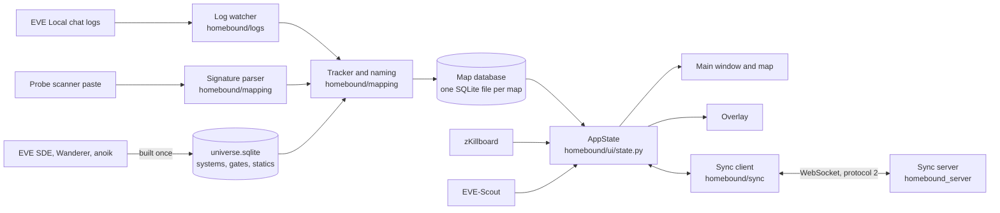

# Architecture

- **Audience:** someone who does not know the code yet: the owner, contributors and coding agents.
- **Scope:** how the parts of Homebound fit together, what each owns and what it must never do. The file behind a feature is in [`code-map.md`](code-map.md); how to use the app is in the [user guide](user/README.md).
- **Kept current:** checked against `302ae37` (2026-11-14). Update it when a part is added or removed, when data starts to flow a new way, or when the sync protocol number changes (now protocol 2, the oldest accepted is 1).

## The parts

Homebound is a desktop app that works alone. An optional sync server lets a group share one map. Everything the app needs about the game world comes from a data file it builds once.

Read the diagram left to right: log lines and pastes turn into map changes; the map database is the single place a map lives; the UI and the overlay only show what the database holds.

## Each part

### Desktop client: log watcher, mapping, map database

- **Owns:** reading the Local logs (`homebound/logs/`), turning jumps and pastes into map changes (`homebound/mapping/`: tracker, naming, signature parser, chain), and storing the map with undo and change recording (`homebound/mapdb/store.py`).
- **Never:** needs an EVE login. The client does not call ESI. It learns where a character is only from the chat logs.
- **Never:** lets a UI class write to the database directly. Changes go through `Store`, so undo and sync see them.
- Files: [code-map §3 and §4](code-map.md#3-features-and-where-they-live).

### Static data: the universe file

- **Owns:** `universe.sqlite`, a read-only database of systems, classes, gates, effects, statics and wormhole types. `homebound/universe/build_static.py` builds it once from the EVE SDE, the Wanderer and anoik.is statics and whtype.info. Where those disagree on a system's statics, zKillboard breaks the tie and the answer is pinned in `data/statics_resolved.json`.
- **Never:** is shipped in a package. The data is CCP's, so each install builds it on first start.
- Files: [code-map §4](code-map.md#4-modules-package-by-package), [data on disk](code-map.md#6-data-on-disk).

### UI and overlay

- **Owns:** the main window, the map scene, the docks and dialogs (`homebound/ui/`), the theme (`homebound/theme/`) and the overlay window. `AppState` (`homebound/ui/state.py`) owns the store, the universe, the tracker and the background workers, and tells the widgets what changed through Qt signals.
- **Never:** holds logic that could live lower. The packages below `ui/` do not import Qt widgets, so they can be tested without a window.
- The overlay follows the focused EVE client through `homebound/platform/` (a KWin script on Plasma, X11 tools, or the Windows API).
- Files: [code-map §1 and §3](code-map.md#1-layers-at-a-glance).

### External services: zKillboard and EVE-Scout

- **Owns:** two optional lookups, `homebound/zkill.py` (kill activity for systems in visible chains, one request per second, cached 10 minutes) and `homebound/eve_scout.py` (public Thera and Turnur connections for routes, every 5 minutes), both through `homebound/http.py`.
- **Never:** sends anything about the user or the map. Both can be turned off in Settings, and the app works without them.

### Sync server and protocol

- **Owns:** shared cloud maps. Clients send operations (per-field changes with a hybrid logical clock); the server merges them last-writer-wins per field and broadcasts the result. Code shared by both sides lives in `homebound/sync/` (`protocol.py`, `merge.py`, `hlc.py`), so both merge the same way. The server (`homebound_server/`) also holds accounts through EVE SSO, billing by ISK payment to a receiving character, and presence.
- **Never:** is required. A local map never touches the network. A client that cannot reach the server keeps working and resends its outbox when it reconnects.
- A protocol change deploys the server first, then the client is released. The wire format is in [`plans/done/sync-protocol.md`](plans/done/sync-protocol.md), the design in [`plans/done/cloud-sync-plan.md`](plans/done/cloud-sync-plan.md) and the operation in [`plans/done/hosting-hetzner.md`](plans/done/hosting-hetzner.md).
- Files: [code-map §5](code-map.md#5-cloud-sync).

### Packaging

- **Owns:** the PyInstaller folder build, the AppImage and AUR package on Linux, the Inno Setup installer and portable zip on Windows (`packaging/`), built by `.github/workflows/release.yml` on a `v*` tag. Releases use the tag's section of `CHANGELOG.md` as notes.
- **Never:** bundles `universe.sqlite` or other game data.
- Files: [code-map §7](code-map.md#7-packaging-tooling-and-ci), [`packaging/README.md`](../packaging/README.md).
