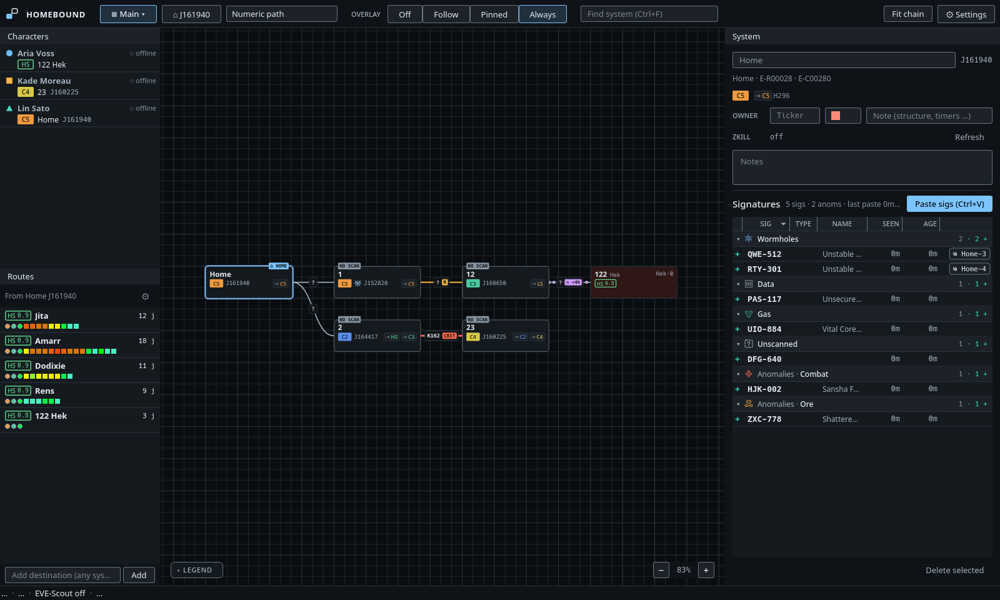

# How to use Homebound

- **Audience:** players using Homebound.
- **Scope:** the contents page of the user guide; one page per topic. What Homebound is and why is in the [README](../../README.md).
- **Kept current:** checked against `702f2d5` (2026-11-14). Update it when a page is added, renamed or removed.

Homebound is a wormhole mapper for EVE Online that runs on your own machine. It learns where your characters go from EVE's Local chat logs, builds the chain as you jump, and names new systems with the scheme you pick. A small overlay over the game shows the chain your active character is in.

Nothing leaves your computer except the one-time download of the map data on first start and optional zKillboard and EVE-Scout lookups. There is no ESI login.

## Pages

1. [Install and first start](install.md)
2. [The main window](main-window.md)
3. [How jumps are tracked](tracking.md)
4. [Naming and bookmarks](naming.md)
5. [Signatures](signatures.md)
6. [Connections, editing by hand and undo](connections.md)
7. [Several maps](maps.md)
8. [The overlay and the tray icon](overlay.md)
9. [Settings, keyboard and mouse](settings.md)
10. [Where your data lives](data.md): backups, restore and network access
11. [Troubleshooting](troubleshooting.md)
12. [Glossary](glossary.md): EVE and Homebound terms
