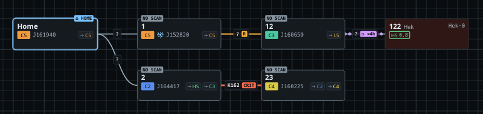

# The main window

- **Audience:** players using Homebound.
- **Scope:** The main window: its panels, system nodes, hole labels and routes. The other topics are on the [contents page](README.md).
- **Kept current:** checked against `702f2d5` (2026-11-14). Update it when the behaviour it describes changes.

| Part | What it does |
|---|---|
| Toolbar | Map menu `▦ Main ▾`, home system, naming scheme, overlay mode, find (Ctrl+F), Fit chain, Settings. |
| Characters (left) | Every character found in the logs: marker, online state and current system. Double-click a row (or Space) to show its system. Right-click → *Pin overlay to this character*. The row the overlay follows is highlighted. |
| Routes (left, under Characters) | Jumps and the way from the selected system (or, with nothing selected, the followed character's system) to the trade hubs and your own destinations. See [Routes](#routes). |
| Map (centre) | Systems and connections. Drag to pan, wheel to zoom, drag a system to move it (it snaps to the grid). Ctrl+click adds systems to the selection, Ctrl+drag on empty canvas draws a selection rectangle, Ctrl+A selects all, Esc clears; dragging any selected system moves them all, and the arrow keys nudge the selection by one grid step (Shift: five). A moved group is one undo step. Legend bottom-left, zoom bottom-right. With more than one map, a `MAP Main` tag in the top-right corner says which map is open. |
| System (right) | The selected system: custom name, owner, notes, zKill activity, and the signature table. |
| Status bar | Log watcher, zKill, EVE-Scout and focus tracking (KWin script, X11 fallback, or Windows), each with ✓ / ▲ / ✕. |

**System nodes** show the custom or scheme name, class, J-name, effect, statics, zKill activity, owner and the characters in it. Home has a `⌂ HOME` tab. A system whose last sig paste is older than the rescan threshold (24h by default, see [Settings](settings.md)) is hatched and faded and gets a grey `SCAN 26h` tab on its top edge. A wormhole system that was never pasted gets `NO SCAN`; k-space systems don't. Hover a node to see the age and the threshold.

High- and low-sec nodes have their empire's colour as background (Amarr gold, Caldari blue, Gallente green, Minmatar red; Ammatar and Khanid space count as Amarr). After the name they show the closest trade hub and its gate jumps, e.g. `Jita·4`. The hub is one of Jita, Amarr, Dodixie, Rens and Hek. The same tag is in the overlay, the tooltip and the System panel.

**Connection lines** show the hole's state:

| Line | Meaning | Chip |
|---|---|---|
| Thin solid | Mass fresh | |
| Thicker solid | Mass reduced (< 50%) | `R` |
| Thick dashed | Mass critical (< 10%) | `CRIT` |
| Short dashes | Mass unknown | `?` |
| Dotted purple casing | Less than 4h left | `◷ <4h` |
| Denser dotted casing | Less than 1h left | `◷ <1h` |
| Faded line, no casing | Expired, removed 10 min after it was set | `✕ EXP` |
| Thin line with a diamond | Frigate only | `F` |
| Orange dashed casing | Drawn by hand, not confirmed yet | `▲ UNCONF` |

Hover a line for details. An expired hole's tooltip counts down to its removal.

Toasts appear in the bottom-right corner of the map and never take focus.

## Routes

The Routes dock lists one row per destination: its class badge, name and jumps, and a strip with one square per system on the way, coloured by security (the client's 1.0 → 0.0 scale; w-space in its class colour). A round dot is a system entered through a wormhole; a violet ring marks an EVE-Scout hole. Hover a row for every system on the route. Double-click a row, or right-click → *Copy route*, to copy the system names.

- **Where routes go:** stargates, the wormholes on the open map, and EVE-Scout's public Thera and Turnur connections. Expired holes are never used. J-space and Pochven destinations work too, as long as a mapped hole or an EVE-Scout connection leads there; otherwise the row says *no known route*.
- **Destinations:** the five trade hubs by default. Type any system (or a map name) in the field at the bottom and press Enter or *Add*, or right-click a system on the map → *Add as route destination*. Right-click a row to move it or remove it. The list is the same for every map.
- **Options (⚙):** *Shortest*, *Safer* (avoids low-, null- and w-space where there is another way) or *Less secure* (avoids high-sec); whether to use EVE-Scout, holes at end of life and mass-critical holes; and the ship size (holes too small for it are skipped; holes of unknown size are used). *Reset destinations to the trade hubs* brings the five hubs back. The same settings are on the Routes page of Settings.
