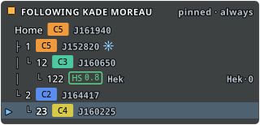

# The overlay and the tray icon

- **Audience:** players using Homebound.
- **Scope:** The in-game overlay, its modes, the tray icon and notifications. The other topics are on the [contents page](README.md).
- **Kept current:** checked against `702f2d5` (2026-11-14). Update it when the behaviour it describes changes.

## The overlay

A small see-through window over the game that shows one character's chain as a tree.

The rows show:
- custom name, class, J-name, effect, kills and pod kills (1h / 24h) and owner
- your current system highlighted with ▶
- k-space systems with their distance, for example "Jita 3j from A"
- the closest trade hub of high- and low-sec systems, for example `Jita·4`

A character in k-space counts as in a chain while within 5 gate jumps of an entrance (configurable). Otherwise the overlay says "Not in a mapped chain".

**Modes** (toolbar, tray or Settings):

| Mode | Shows |
|---|---|
| Off | nothing |
| Follow active client | the chain of the character whose EVE window has focus; hidden when no EVE window has focus |
| Pinned · over all clients | one chosen character, whenever any EVE window has focus |
| Pinned · always shown | one chosen character, all the time |

Pin a character first: right-click it in the Characters list → *Pin overlay to this character*.

The overlay ignores the mouse, so clicks go through to the game. To move it, choose **Unlock overlay** in the tray menu, drag it, then lock it again. The position is saved per mode.

**Follow active client** needs to know which EVE window has focus. On KDE Plasma (Wayland), install the KWin script once: **Settings → KWin focus script → Install**. Without it, Homebound falls back to polling the X11 active window, which doesn't see every focus change under Wayland. On Windows nothing needs installing: Homebound reads the title of the foreground window, as the task bar does.

On Linux the overlay is an X11 override-redirect window, so it stays above fullscreen EVE clients. **On Windows, run EVE in windowed or borderless (fixed window) mode.** The overlay stays above those, but Windows doesn't let any window sit above an exclusive-fullscreen game.

## Tray icon and notifications

Closing the main window keeps Homebound running in the tray. The tray menu has:
- Unlock overlay
- the overlay modes, and "Next overlay mode" with its shortcut
- Show map window
- Settings …
- Quit

Click the icon to bring the window back. The icon is dimmed while the overlay is off.

While the main window is hidden, toasts are also sent as desktop notifications.
