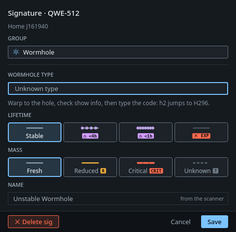

# Signatures

- **Audience:** players using Homebound.
- **Scope:** Pasting probe scanner results, the signature table and the signature editor. The other topics are on the [contents page](README.md).
- **Kept current:** checked against `702f2d5` (2026-11-14). Update it when the behaviour it describes changes.

## Pasting

1. Select a system on the map.
2. In the probe scanner, press Ctrl+A, then Ctrl+C.
3. Press **Ctrl+V** anywhere in Homebound, or click *Paste sigs*.

New sigs get a `+`. Known sigs are updated, but known information is never replaced with less (a named site stays named).

Sigs that are no longer in the scanner are flagged `−` and struck through. A banner says how many, for example "2 sigs missing from the last paste · anomalies untouched". Choose **Keep** or **✕ Delete n**. Only the kinds in the paste are checked: if you paste just signatures, your anomalies stay as they are, and the other way round.

The summary above the table says when you last pasted, for example "last paste 2h ago". Once that is older than the rescan threshold, it turns amber and reads "▲ rescan due", and the rows are drawn faint. An empty system gives nothing to paste: right-click it on the map → **Mark as scanned now**. This also quiets `NO SCAN` on a system you don't care about. It only changes the time of the last paste, so there's nothing to undo.

## The table

- Rows are grouped: Wormholes, Combat, Data, Relic, Gas, Ore, Ice and Unscanned, then *Anomalies · Combat*, *Anomalies · Ore* and so on.
- Click a group header to collapse it, even when its rows are new or missing. Homebound remembers this per map. A paste opens the groups it changed (new sigs, and sigs that just went missing), so you see them once; collapse them again if you like.
- The header shows the count, plus `· 1 −` / `· 1 +` when rows are missing or new.
- Click a column header (Sig, Type, Name, Seen, Age) to sort the rows inside every group; click it again to reverse. Homebound remembers the order per map.
- Drag the rules between the column headers to resize them. The widths are remembered.
- Select rows and click *Delete selected* (or press Del) to remove them.
- Right-click a wormhole sig (or select it and press **R**) → **Return hole to A**: it marks that sig as the hole in this system that leads back to the system you jumped in from (A; if you didn't jump in, the parent, else you pick from the connections that have no sig on this side yet). Homebound links the sig to that connection, sets where it leads, and fills in its type from the other side: K162 when A's side is a real type, the real type when A's side is a K162 (set only when exactly one type fits, otherwise the editor lists the candidates first). Mass, lifetime and size are copied from the connection. One Undo takes it all back. After a paste, if exactly one unlinked sig looks like that hole, its row shows a **↩ Return hole?** button; nothing is linked until you click it. When A is the parent, its bookmark reads `S-0` and the row says `→ A · return`.
- For a wormhole sig, the Name column shows where it leads (`→ A2`) or what you entered in the editor (`→ C3 · M · ◷ <1h · R`).

## The signature editor

Double-click a sig (not an anomaly) to enter what the scanner can't show.

| Field | When | Notes |
|---|---|---|
| Group | always | Wormhole, Combat, Data, Relic, Gas, Ore, Unscanned. |
| Wormhole type | wormholes | See the dropdown order below. Each row shows the type's destination, size, lifetime and total mass; `STATIC` marks this system's statics. Type the start of a code to jump to it (`b2` → B274). |
| Leads to | K162 only | Any other type already says where it goes. |
| Size | K162 only | Frigate (S), Medium, Large, Capital. Size S makes the connection frigate-only. |
| Lifetime | wormholes | Stable · ◷ <4h · ◷ <1h · ✕ EXP. Each button shows the line it will draw on the map. |
| Mass | wormholes | Fresh · Reduced R · Critical CRIT · Unknown ?. |
| Name | always | Editable for sites; for wormholes it is always "Unstable Wormhole". |

The type dropdown lists, in this order:
1. Unknown and K162.
2. This system's statics.
3. Every type that can wander into this class, A–Z (from whtype.info; a type that only ever spawns as another system's static isn't listed).
4. *Show all types …*, which adds the rest, dimmed.

The **lifetime clock** starts when you set a state, and the line under Lifetime shows it, for example "End of life since 17:55 · removed at about 21:55". The connection is removed 4h, 1h or 10 min after the state was set. Saving the same state again keeps the clock.

If the sig is already linked to a connection, a banner says so, and saving updates the connection too. Information entered on an unlinked sig carries over to the connection once someone jumps through it.

**✕ Delete sig** removes it at once. Undo is in the toast.
